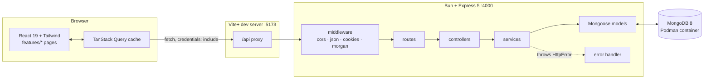
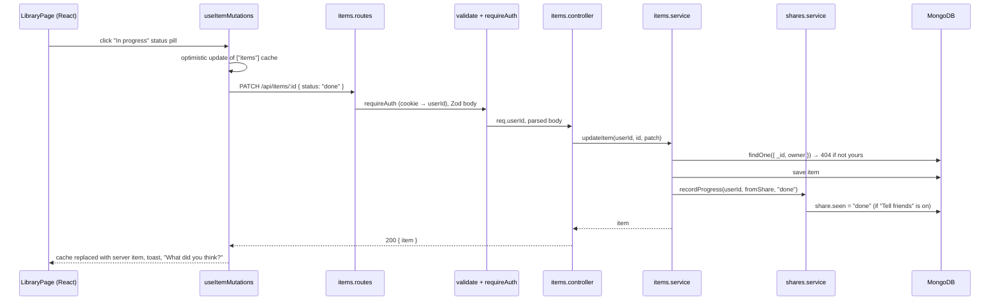

# Architecture

Second Brain is a MERN app run on Bun: a React single-page client, an Express 5 API and MongoDB.

## System

- **Auth:** a JWT in the httpOnly cookie `sb_token` (7 days, or a browser session when "Keep me logged in" is off). `requireAuth` also rejects tokens issued before the last password reset.
- **Validation:** Zod schemas at the edge (`validate({ body, query, params })`). Services trust their input.
- **Errors:** services throw `HttpError(status, message, fields?)`. The error handler maps it, Zod errors (400), duplicate keys (409) and bad JSON (400) to `{ error: { message, fields? } }`.

## One request through the layers

Marking a link a friend shared as finished:

## Code layout

| Server `server/src/` | Purpose |
|---|---|
| `app.ts`, `index.ts` | Build the Express app (exported for tests) / connect and listen |
| `config/env.ts` | Validated environment (Zod) |
| `middleware/` | `requireAuth`, `validate`, `errorHandler`, cookies |
| `models/` | `User`, `Item`, `Friendship`, `Share`, `InboxEntry`, `Group` |
| `modules/<feature>/` | `*.routes.ts` → `*.controller.ts` → `*.service.ts` (+ `*.schemas.ts`, `*.test.ts`) for auth, users, items, friends, shares, inbox, groups, notifications |
| `seed.ts` | Demo data (`bun run seed`) |

| Client `client/src/` | Purpose |
|---|---|
| `app/` | Router, providers (Query, Theme, Toast, Auth) |
| `features/<feature>/` | `api/`, `hooks/`, `components/`, `pages/`, `index.ts` (the only import point for other features) |
| `components/layout`, `components/ui` | App shell (rail, top bar) and UI primitives (Modal, Dropdown, Field…) |
| `lib/` | API client, URL and date helpers, social cache refresh |
| `styles/index.css` | Tailwind v4 theme tokens ported from the prototype, light and dark |
