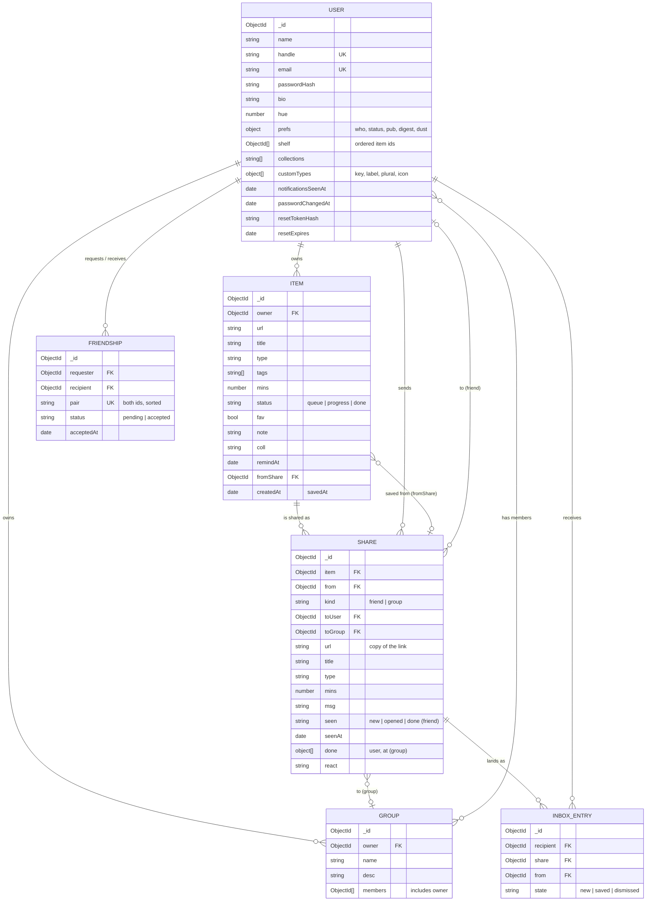

# Data model

**Cascades** (done in services):
- **Deleting an item** deletes its shares and their inbox entries.
- **Removing a friend** deletes direct shares and their entries, both ways.
- **Leaving a group** (or being removed) deletes your entries for its shares. When the owner leaves, the group is deleted with its shares.
- **Deleting an account** removes the user's items, sent and received shares, inbox entries, friendships and owned groups, and takes them out of other groups.
